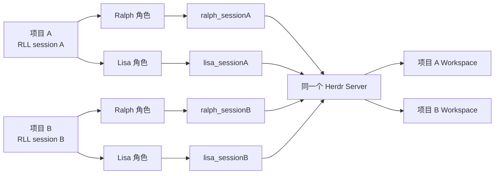
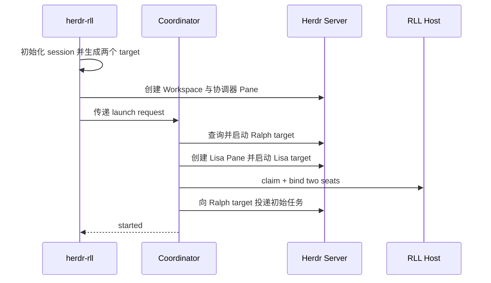
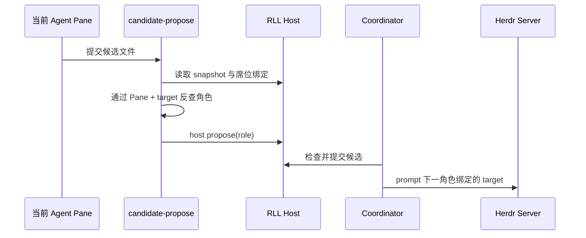

# Herdr 多项目 Agent 隔离实施方案

## 1. 文档信息

| 项目 | 内容 |
|---|---|
| 文档状态 | 发布准备中（四个实施切片和真实验收已完成，尚未合并或公开发布） |
| 编写日期 | 2026-11-12 |
| 最近更新 | 2026-11-13 |
| 目标分支 | `feat/herdr-multi-project-seats` |
| 基线提交 | `eb79a833f2938cb8befffa50068fd3bffab3e0f9` |
| 目标仓库 | `Click-Intelligence-LLC/ralph-lisa-herdr` |
| 基线公开插件版本 | `0.1.8` |
| 基线公开 CLI 版本 | `0.3.14` |
| 本分支发布准备版本 | 插件 `0.1.9`、CLI `0.3.15` |

本文档是 Herdr 多项目并行支持的实施基线。后续开发、测试、真实验收、提交和发布均以本文档为准。实施中如果发现 Herdr 实际接口与本文档假设不一致，应先更新本文档并记录验证证据，再修改实现。

### 1.1 实施进度

| 切片 | 当前状态 | 已完成内容 | 验证状态 |
|---|---|---|---|
| 1. 会话级 Agent target | 已完成 | CLI 生成并持久化会话级 target；插件启动、预检、提示投递、自动交接和预认领恢复按绑定 target 定位 Agent；旧启动记录继续兼容固定 target | CLI 522/522；插件 61/61；发布包 96 个文件校验通过；远端 Node 18/20/22 CI 通过 |
| 2. 候选、任务更新与恢复 | 已完成 | 候选适配器按 Pane 从 Host Binding 解析业务角色并核对 target；聊天任务更新保存绑定 target；恢复和接续观察按持久化 target 查询；兼容旧固定 target | 插件定向测试 13/13；插件全量测试 63/63；远端 Node 18/20/22 CI 通过 |
| 3. 失败启动安全接续 | 已完成 | 同任务、同模式、同 session、同 Workspace/根 Pane/target 且 Host 未认领、零游标、无候选时复用原请求；协调器继续核验旧进程和完整席位；其余现场返回 `RECOVERY_REQUIRED` | CLI 定向测试 11/11；CLI 全量测试 524/524；发布包 96 个文件校验通过；远端 Node 18/20/22 CI 通过 |
| 4. 真实验收与发布文档 | 已完成，待发布 | 同 Server 四个唯一 target；两个项目分别完成双向交接并在后续手工复验中都自动完成；项目 A 恢复时 B 不变化；动态 target、Host 超时和不透明 Workspace ID 兼容问题均已修复；验收记录、README 和版本已同步 | CLI 526/526、插件 66/66；Workspace ID 修复提交 `687c42b` 的远端 Node 18/20/22 CI 通过；详见 `multi-project-agent-isolation-acceptance-2026-11-13.md` |

## 2. 问题与已确认原因

### 2.1 实际表现

同一个 Herdr Server 中，项目 A 已经启动 Ralph/Claude 与 Lisa/Codex，且项目 A 的 Pane 仍然打开时，再启动项目 B，项目 B 会出现：

```text
AGENT_IDENTITY_MISMATCH
```

关闭项目 A 的 Agent Pane 后，项目 B 可以继续启动。这个规避方式不满足多项目并行使用要求。

### 2.2 根因

插件当前把 RLL 业务角色直接作为 Herdr Agent 名称：

```text
RLL role: ralph  -> Herdr Agent name: ralph
RLL role: lisa   -> Herdr Agent name: lisa
```

启动、查询、提示投递、候选提交、任务更新和恢复逻辑均存在这一假设：

```text
herdr agent get ralph
herdr agent start ralph --kind claude
herdr agent prompt ralph "..."
```

第二个项目会查询到第一个项目仍然存活的同名 Agent。插件发现其 Workspace、Pane 或项目路径不属于当前项目，于是以 `AGENT_IDENTITY_MISMATCH` 停止。

### 2.3 现有协议能力

RLL Host Binding 已经将以下概念分开：

- `role`：`ralph` 或 `lisa`，表示业务职责与轮次。
- `agent_target`：Herdr 中用于查询和投递的 Agent 标识。

`agent_target` 已允许使用非空 opaque string，也已参与候选、确认、自动授权和提交一致性检查。因此本次改造不修改 Host Binding schema，也不重做 RLL 轮次协议。

## 3. 实施目标

一个 Herdr Server 中必须支持多个 RLL 项目同时存在：

1. 项目 A 和项目 B 可分别拥有 Ralph 与 Lisa。
2. 项目 A 的 Agent Pane 保持打开时，项目 B 可以正常启动。
3. 两个项目可以同时等待输入、生成候选或执行交接。
4. 项目 A 的提示、候选、任务更新和交接不得进入项目 B。
5. 任一项目重启、重绑或接续时，不得接管其他项目的 Agent。
6. v0.1.8 已创建的旧会话仍可按原绑定恢复。
7. 启动失败后的安全重试不得重复发送已接受的提示。

## 4. 目标架构



业务角色继续使用 `ralph`、`lisa`。Herdr Agent 使用会话级唯一名称。所有运行时操作通过 Host Binding 中的 `agent_target` 定位实际 Agent。

## 5. Agent target 规则

### 5.1 名称格式

对 RLL `session_id` 去掉连字符，截取前 16 个十六进制字符作为会话 token：

```text
token = compact(session_id)[0:16]
ralph_target = "ralph_" + token
lisa_target  = "lisa_" + token
```

示例：

```text
session_id:   6eac48cf-7590-4052-8aa9-b6882a9dcf12
ralph_target: ralph_6eac48cf75904052
lisa_target:  lisa_6eac48cf75904052
```

### 5.2 规则要求

- 相同 session 必须得到相同 target。
- 不同 session 必须得到不同 target。
- Ralph 与 Lisa target 必须不同。
- 名称只包含小写字母、数字和下划线。
- 名称不得包含项目路径、用户名或任务正文。
- target 必须在启动第一个 Agent 前持久化。
- 重启和恢复必须读取持久化 target。
- 已存在 Host Binding 时，以 Binding 中的 `agent_target` 为最终依据。

### 5.3 碰撞处理

启动前执行 `herdr agent get <target>`：

- 返回 `agent_not_found`：允许启动。
- 返回当前 Workspace、Pane、项目路径和 Agent 类型完全一致的 Agent：作为安全重试继续。
- 返回属于其他位置的 Agent：返回 `AGENT_TARGET_COLLISION`。

发生碰撞后不得临时改名、接管现有 Agent 或继续投递。现场应保留给恢复检查。

## 6. 持久化数据改造

### 6.1 启动 Workspace 记录

在 `.dual-agent/herdr-launch-workspace.json` 中增加：

```json
{
  "schema": 1,
  "request_id": "...",
  "workspace_id": "w4",
  "root_pane_id": "w4:p1",
  "root_terminal_id": "...",
  "agent_targets": {
    "ralph": "ralph_6eac48cf75904052",
    "lisa": "lisa_6eac48cf75904052"
  }
}
```

`agent_targets` 对新启动记录为必填字段。读取旧启动记录时允许缺失，并进入旧会话兼容逻辑。

### 6.2 插件协调器记录

协调器 `record.json` 在启动 Agent 前写入：

```json
{
  "agent_targets": {
    "ralph": "ralph_6eac48cf75904052",
    "lisa": "lisa_6eac48cf75904052"
  }
}
```

协调器在 Ralph 已启动、Lisa 尚未启动时退出，预认领恢复仍可找到原 Ralph，不会重新生成名称。

### 6.3 Host Binding

Host Binding 保持 schema 1：

```json
{
  "seats": {
    "ralph": {
      "pane_id": "w4:p1",
      "agent_target": "ralph_6eac48cf75904052"
    },
    "lisa": {
      "pane_id": "w4:p3",
      "agent_target": "lisa_6eac48cf75904052"
    }
  }
}
```

## 7. 运行时身份检查

每次启动、投递、提交、重绑和接续都必须同时核对：

```text
project_realpath
session_id
workspace_id
pane_id
terminal_id
agent_target
agent kind
native session fingerprint（已经记录时）
```

任一项不一致时停止运行。禁止只根据 Ralph/Lisa 角色名称查找 Agent。

## 8. 逐文件修改方案

### 8.1 新增 `cli/src/herdr/seat-target.ts`

职责：

- 校验 `session_id`。
- 生成 Ralph/Lisa target。
- 校验从启动记录读取的 target。
- 提供固定测试向量，避免 CLI 与插件生成规则漂移。

建议接口：

```ts
export type HerdrSeatTargets = { ralph: string; lisa: string };
export function targetsForSession(sessionId: string): HerdrSeatTargets;
export function validAgentTarget(value: unknown): value is string;
```

### 8.2 修改 `cli/src/herdr/launch-record.ts`

- `recordLaunchWorkspace` 接收 `agentTargets`。
- 在 `herdr-launch-workspace.json` 持久化 target。
- 读取时校验两个 target 非空且不同。
- 旧记录允许没有该字段。

### 8.3 修改 `cli/src/herdr/launch.ts`

1. 初始化 session 后立即生成 target。
2. 创建 Workspace 后将 target 写入启动记录。
3. `blockedAgent` 使用当前会话的 target 查询 Agent。
4. 返回的 `blocked_role` 仍为业务角色 `ralph/lisa`。
5. 第二阶段加入安全的失败启动接续，参见第 11 节。

### 8.4 新增 `integrations/herdr/seat-targets.mjs`

职责：

- 根据 session 生成 managed target。
- 从 plan、record 和 launch workspace 中解析 target。
- 为旧会话提供固定名称回退。
- 根据当前 Agent 与 Host Binding 反查 RLL 业务角色。

建议接口：

```js
targetsForSession(sessionId)
targetsForManagedLaunch(launch)
targetForRole(plan, role)
roleForBoundAgent(snapshot, agent, pane)
legacyTargets()
```

### 8.5 修改 `integrations/herdr/coordinator.mjs`

固定名称调用：

```text
agent get <role>
agent start <role>
agent prompt <role>
```

统一改为：

```text
target = plan.seats[role].agent_target
agent get <target>
agent start <target>
agent prompt <target>
```

具体修改：

- `missingAgent` 接收 target。
- `waitForAgent` 同时接收 role 与 target。
- `launchAgent` 同时接收 role 与 target。
- `bootstrapSeats` 在启动 Agent 前保存 `agent_targets`。
- `resumePreclaimSeats` 使用 record 中已保存的 target。
- `observeSeat` 按 `expected.agent_target` 查询和核验。
- `submitPrompt` 按 `plan.seats[role].agent_target` 投递。
- 提示回执中的 Agent name 必须等于绑定 target。
- 自动候选检查使用绑定 target。
- 任务更新请求检查使用 Ralph 实际 target。

业务消息、轮次、候选角色和 UI 中的角色名称继续使用 `ralph/lisa`。

### 8.6 修改 `integrations/herdr/actions.mjs`

`seat-preflight` 接收明确的 target 映射：

```text
role=ralph, target=ralph_<token>, kind=claude
role=lisa,  target=lisa_<token>,  kind=codex
```

输出的 Binding Plan 保存实际 target。恢复检查必须读取 `record.plan.seats[role].agent_target`，不能重新假设 target 与 role 相同。

### 8.7 修改 `integrations/herdr/candidate-propose.mjs`

删除以下身份推断：

```js
const role = agent.name;
```

新流程：

1. 通过当前 Pane 读取实际 Agent。
2. 读取 RLL snapshot。
3. 在 `snapshot.seats` 中查找唯一匹配：

```text
seat.pane_id == current pane_id
seat.agent_target == agent.name
```

4. 匹配 Ralph 席位则 role 为 `ralph`。
5. 匹配 Lisa 席位则 role 为 `lisa`。
6. 无匹配或多匹配返回 `SEAT_BINDING_MISMATCH`。

候选中的 `intended_agent_target` 必须等于实际 Binding target。

### 8.8 修改 `integrations/herdr/task-update-request.mjs`

任务更新只允许当前 Ralph 席位发起：

```text
agent.name == snapshot.seats.ralph.agent_target
agent.agent == claude
agent.pane_id == snapshot.seats.ralph.pane_id
agent.workspace_id == snapshot.workspace_id
agent.cwd == snapshot.project_realpath
```

请求记录中的 `agent_target` 写入实际 target。协调器处理请求时按计划中的 Ralph target 核验。

### 8.9 修改控制与审阅页面

控制页显示：

```text
Role: Ralph
Project: <项目目录名称>
Agent: ralph_6eac48cf75904052
Workspace: w4
Pane: w4:p1
```

用户主要看到 Role 与 Project，Agent target 作为诊断信息展示，避免多个项目都显示完全相同的 Ralph/Lisa 条目。

## 9. 旧会话兼容策略

解析 target 的优先级：

1. `record.plan.seats[role].agent_target`
2. `record.agent_targets[role]`
3. `herdr-launch-workspace.json.agent_targets[role]`
4. 旧会话回退为固定 `ralph`、`lisa`

兼容要求：

- 新项目使用会话级 target。
- 旧项目使用已经保存的固定 target。
- 旧项目重启时不得突然创建新 Agent。
- 已完成项目无需迁移。
- 旧固定名称被其他项目占用时，返回明确冲突并保留现场。
- 重绑与接续始终使用旧 Binding 中保存的 target。

## 10. 启动、投递与交接流程

### 10.1 新项目启动



### 10.2 候选交接



## 11. 启动失败后的安全重试

当前启动在创建 `.dual-agent` 后失败时，再次执行可能直接返回 `SESSION_EXISTS`。本问题作为同分支第二个独立功能切片处理。

允许自动接续必须同时满足：

```text
session_id 未改变
任务 SHA-256 未改变
host_state == unclaimed
generation == null
candidate_count == 0
没有 accepted delivery
没有正式提交回执
旧协调器进程已退出
启动记录属于原 request
Workspace、Pane 和 target 与记录一致
```

满足条件时复用原 session、Workspace、Pane 和 target，并从持久化阶段继续。已经 accepted 的提示不得重复投递。

不满足条件时返回 `RECOVERY_REQUIRED`，保留全部现场，不删除 `.dual-agent`，也不自动创建新会话。

## 12. 错误码规划

| 错误码 | 含义 |
|---|---|
| `AGENT_TARGET_INVALID` | 生成或读取的 target 不符合约束 |
| `AGENT_TARGET_COLLISION` | 同名 target 已属于其他位置 |
| `AGENT_TARGET_MISMATCH` | Agent name 与 Binding target 不一致 |
| `SEAT_BINDING_MISMATCH` | 当前 Pane/Agent 无法唯一映射到 RLL 席位 |
| `PRECLAIM_TARGETS_MISSING` | 新格式预认领记录缺少 target |
| `RECOVERY_REQUIRED` | 现场不能安全自动接续 |

现有 `AGENT_IDENTITY_MISMATCH` 继续用于 Agent 类型、Workspace、Pane、terminal 或项目路径不一致。控制页只显示角色和受限诊断字段，不输出原生会话 ID 或任务正文。

## 13. 自动测试计划

### 13.1 target 单元测试

- 相同 session 生成相同 target。
- 不同 session 生成不同 target。
- Ralph/Lisa target 不同。
- target 满足格式和长度要求。
- 非 UUID session 被拒绝。
- CLI 与插件对固定 session 生成相同结果。

### 13.2 actions 测试

- `seat-preflight` 接受别名 Agent。
- target 正确、Workspace 错误时拒绝。
- target 正确、项目路径错误时拒绝。
- target 正确、Pane 或 terminal 错误时拒绝。
- 两个角色使用相同 target 时拒绝。
- 旧固定名称记录仍可读取。

### 13.3 candidate adapter 测试

- Ralph 别名正确映射为 `ralph`。
- Lisa 别名正确映射为 `lisa`。
- 相同 Pane、错误 target 被拒绝。
- 相同 target、错误 Pane 被拒绝。
- 候选保存实际 `intended_agent_target`。

### 13.4 task update 测试

- Ralph 别名可以请求 supplement/switch。
- Lisa 别名不能请求 Ralph 任务更新。
- 旧固定 Ralph 仍兼容。
- 请求记录保存实际 Ralph target。
- 协调器拒绝 target 不一致的请求。

### 13.5 Coordinator 多项目测试

在一个 fake Herdr Server 中：

1. 启动项目 A 并保持两个 Agent 存活。
2. 启动项目 B。
3. 确认存在四个唯一 target。
4. A 提交候选，只向 A 的 Lisa 投递。
5. B 提交候选，只向 B 的 Lisa 投递。
6. A 执行 Lisa→Ralph，B 的 generation 不变化。
7. B 执行 Lisa→Ralph，A 的 generation 不变化。
8. 重启 A 协调器，B 继续保持原状态。
9. 分别停止两个协调器，租约只释放各自项目。

### 13.6 旧会话回归测试

- 无 `agent_targets` 字段的旧 record 使用 `ralph/lisa`。
- 已绑定旧 target 的恢复检查仍通过。
- 升级后旧会话不会重新创建带后缀 Agent。
- 新会话与旧会话同时存在时，新会话使用唯一 target。

## 14. 真实 Herdr 验收方案

真实验收使用独立 XDG 配置目录、单独命名 Server、固定 Git 提交和两个全新临时项目，不操作默认 Herdr Server。

验收步骤：

1. 安装待验收提交并确认插件来源、版本和 checkout HEAD。
2. 在项目 A 启动 `herdr-rll --full-auto`。
3. 保持 A 的 Workspace 与两个 Agent Pane 打开。
4. 在项目 B 启动 `herdr-rll --full-auto`。
5. 确认 Agent 列表中有四个唯一 target。
6. 分别核对两个项目的 Host Binding。
7. 项目 A 完成 Ralph→Lisa→Ralph。
8. 项目 B 完成 Ralph→Lisa→Ralph。
9. 核对每份 delivery、receipt、generation 和目标 Pane。
10. 重启项目 A 的协调器并执行恢复接续。
11. 确认项目 B 没有新增提示、回执或 generation 变化。
12. 停止测试 Server，卸载隔离插件并清理临时目录。

真实验收通过条件：

```text
项目 A 的 Agent Pane 保持打开时，项目 B 可以正常启动；
两个项目分别完成至少一次双向交接；
没有发生跨项目提示、候选、提交、任务更新或恢复接管。
```

目录信任、模型余额、Agent 登录等外部阻断应单独记录，不计为多项目隔离逻辑通过。

## 15. 实施切片与 Git 提交

### 切片 1：会话级 Agent target

```text
feat(herdr): assign session-scoped agent targets
```

包含 target 生成与持久化、Coordinator 启动/查询/投递、seat preflight 和基础测试。

### 切片 2：候选、任务更新与恢复

```text
fix(herdr): resolve roles through bound agent targets
```

包含 candidate adapter、task update adapter、自动候选核验、恢复链路和旧会话测试。

### 切片 3：失败启动安全接续

```text
fix(herdr): safely resume failed preclaim launches
```

包含 `SESSION_EXISTS` 前置状态判断、同任务安全接续、防重放和 `RECOVERY_REQUIRED`。

### 切片 4：真实验收与发布文档

```text
docs(herdr): record concurrent project acceptance
```

包含真实验收记录、README 多项目说明、兼容说明和版本更新。

每个切片执行：

```text
实现
→ 聚焦测试
→ 完整本地回归
→ Git 提交
→ 推送功能分支
→ 检查 Node 18/20/22 CI
→ 开始下一切片
```

## 16. 发布门禁

满足以下条件后才允许发布：

- CLI 构建成功。
- 插件测试全部通过。
- CLI Node 18/20/22 CI 全部通过。
- 同 Server 双项目 fake-Herdr 测试通过。
- 真实 Herdr 双项目验收通过。
- 旧会话恢复回归通过。
- 公共 GitHub 安装测试通过。
- npm 隔离 prefix 安装测试通过。
- 插件版本、npm 版本、tag 和 README 一致。

截至 2026-11-13，代码与发布前门禁状态如下：

- CLI 构建、CLI 526/526、插件 66/66、96 个发布文件检查通过。
- CLI `0.3.15` 已要求插件至少为 `0.1.9`；旧插件不会接收新 target 启动契约。
- 插件 action/pane 直接启动已按 session 派生 target，且混合新旧 target 失败关闭。
- 同一 fake Herdr Server 的双项目测试已创建四个唯一 target，完成两项目各自双向交接并验证停止/错误重启隔离。
- 同 Server 双项目真实验收和旧会话兼容回归通过。
- 公司 GitHub `main@4cce15e9acffbc8346c790e0a650885dbf8a10c6` 隔离安装成功，插件 `0.1.9` 的 doctor 为 `ready`。
- CLI `0.3.15` 本地 tarball 已安装到全新 prefix，两个命令入口通过；SHA-256 为 `21e184e787a26440d2ec67e3e9a9ba6c88c55a3b5a010561648badc7a5882d19`。
- 最终主分支远端 Node 18/20/22 CI（运行 `43391815373`）已通过。
- 多项目功能 PR #3 和 Node 18 测试桩 hotfix PR #4 均已合并；发布准备 PR、tag、公共 npm 发布和发布后公共来源冒烟仍是发布门禁，不得用本地 tarball 结果替代。

建议发布顺序：

1. 合并发布准备分支并等待主分支 CI。
2. 让插件 `v0.1.9` 和 CLI `cli-v0.3.15` 标签指向同一个最终发布提交。
3. 发布 npm `ralph-lisa-loop@0.3.15`。
4. 从公共来源重新安装插件和 npm CLI。
5. 运行发布后外部终端、Herdr Pane 不透明 Workspace ID 和双项目冒烟测试。
6. 确认 Herdr 市场索引到新插件版本。

## 17. 回滚方案

如果真实验收发现串线或恢复异常：

1. 停止发布流程。
2. 保留失败项目的 `.dual-agent` 和插件 session record。
3. 停止测试命名 Server。
4. 将公开安装版本保持在插件 `0.1.8`、CLI `0.3.14`。
5. 按功能切片回退对应提交。
6. 不自动转换或删除用户已有 Host Binding。

代码回滚不能改变已创建会话的 target。旧版本无法识别新 target 时，应停止并提示版本不匹配，用户升级后再恢复。

## 18. 完成定义

以下项目全部完成后，本实施方案才算交付完成：

- 新会话使用会话级唯一 Agent target。
- 所有提示、候选、任务更新和恢复操作使用 Binding target。
- 同一 Herdr Server 可同时运行至少两个 RLL 项目。
- 双项目分别完成真实双向交接。
- 旧会话兼容测试通过。
- 启动失败可在严格门禁下安全接续。
- 本地测试、GitHub CI、真实 Herdr 验收和发布后冒烟测试均有独立证据。
